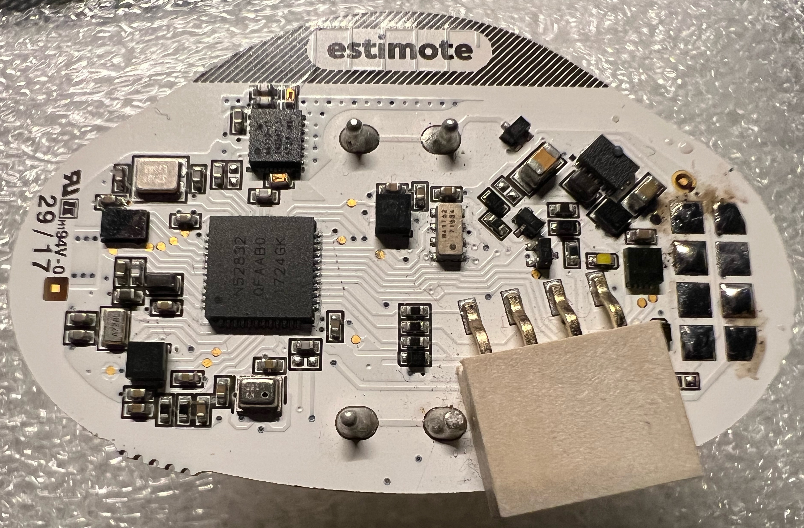
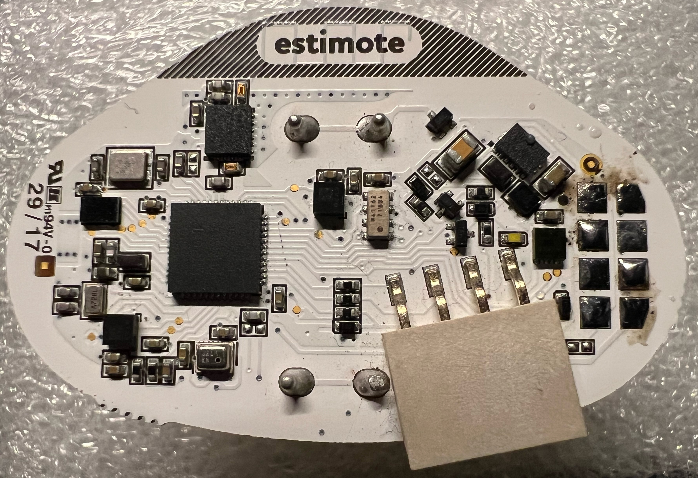
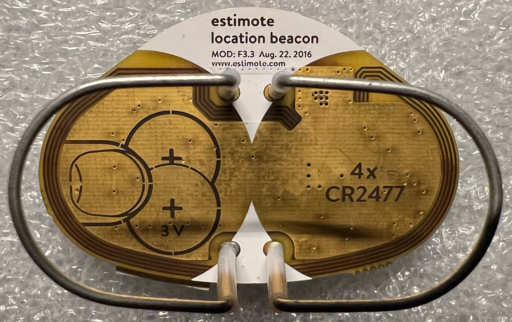
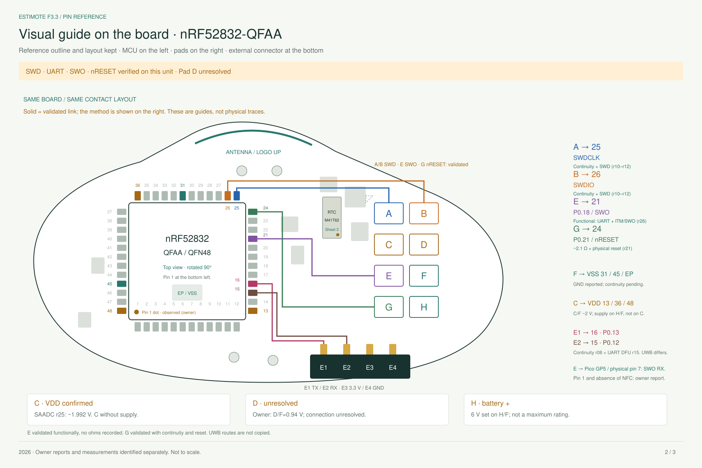

# A second life for an Estimote Location Beacon F3.3

Research and custom firmware for the beacon labelled
**MOD: F3.3 — Aug 22, 2016** (nRF52832). Independent project: not affiliated
with, sponsored or endorsed by Estimote, Inc. or Nordic Semiconductor. All
trademarks belong to their owners.

**Keywords:** Estimote Location Beacon, F3.3, nRF52832, custom firmware,
APPROTECT unlock, SWD, Raspberry Pi Pico debugprobe, Adafruit nRF52 bootloader,
S132 SoftDevice, BLE GATT, OTA DFU, UART JSON, ESP32, LIS2DH12, LIS3MDL,
BMP280, MAX44009, M41T62, beacon pinout, reverse engineering, repurposing.







More macro details (RTC, pressure sensor, RF amplifier, power section) in
[macro photos](docs/evidence/photos-unit-r28-2026-11-19/derived/details/).

> [!WARNING]
> **For educational purposes only. Use at your own risk.**
> This repository documents what was done with **one** specific unit. Following
> it means opening the case, soldering or clipping wires to tiny pads and
> **completely erasing the original Estimote firmware, which cannot be
> recovered** (it was protected with APPROTECT and no backup exists). You may
> brick the beacon or damage your adapter or computer. The authors accept no
> liability for any damage, loss or misuse.
>
> Another unit, revision or batch may differ: **you may need to adapt pins,
> voltages, scripts or firmware**. Check every connection with a multimeter
> before powering anything, and do not trust any pin assignment until you have
> measured it on your own board.

This project began in 2026 to reuse an F3.3 that was no longer supported.

## Status (validated in 2026)

**It works.** The board runs an Adafruit bootloader (r46) with the S132 6.1.1
SoftDevice and the custom application **`f33-ble-sensors` 1.0.0**:

| Sensor | Chip | I²C address | Validated with |
|---|---|---|---|
| Acceleration | LIS2DH12 | 0x19 | Gravity ≈1.04 g and movement |
| Magnetic field | LIS3MDL | 0x1E | 360° rotation (0.25 G circle; the ≈1.3 G hard-iron offset is not calibrated yet) |
| Pressure and temperature | BMP280 | 0x77 | ≈1006 hPa; heat from a hair dryer (26.8 → 43.7 °C) |
| Light | MAX44009 | 0x4A | Covered / flashlight (22 → 1060 lx) |
| Real-time clock | M41T62 | 0x68 | Seconds counting |
| Battery and VDD | divider on AIN3 | — | 3–6 V sweep with an adjustable supply |

Data can be read **over Bluetooth** (`F33` advertisement, GATT with
notifications) and, with a 3.3 V host on the external E1–E4 connector,
**over UART as JSON**. Firmware can be updated **without opening the case**
(BLE or E1–E4).

**Full guide: [docs/guide-f33.md](docs/guide-f33.md)** — wiring, power,
data format, commands, reprogramming and lessons learned.

Custom firmware adds open BLE/UART sensor access and updates. It replaces the original Estimote firmware, configuration and proprietary behavior; factory calibration and features are not guaranteed to carry over. Full erase is irreversible: no factory recovery image is provided. Incorrect wiring, voltage or programming can permanently damage the device. Review these consequences and explicitly authorize each critical step before proceeding.

## Recommended tools

- **Multimeter** (continuity and voltage). Board connections were validated;
  results and remaining open points are detailed in the [guide](docs/guide-f33.md).
- **A 3.3 V go-between**, e.g. a **Raspberry Pi Pico** running
  [debugprobe](https://github.com/raspberrypi/debugprobe) (v2.3.1). It works
  as both SWD programmer and USB‑UART bridge. An ESP32 DevKit V1 also
  reads sensors over UART and BLE ([hardware results](docs/evidence/esp32-readers-2026/README.md)); a real Raspberry Pi host remains untested.
- **Adjustable bench supply** with current limit (3.3 V on E3; never 5 V
  on E3: that gives 4.58 V on VDD, above the nRF absolute maximum).
- **Macro camera** (or USB microscope / magnifier with good light). **Highly
  recommended:** macro photos made it possible to read chip markings (M41T62,
  SKY66110, nRF52832), follow small traces and vias, find pin 1 of the nRF and
  number contacts. Photograph both sides before touching anything.
- Thin wires, hook clips or a fine-tip soldering iron.
- To build: [Arm GNU Toolchain](https://developer.arm.com/downloads/-/arm-gnu-toolchain-downloads) 15.2.rel1
  and the [Adafruit bootloader](https://github.com/adafruit/Adafruit_nRF52_Bootloader)
  repository at commit `c67f0bc` (provides S132, nrfx and CMSIS headers).

## Essential connections

Orientation: antenna up, eight pads A–H on the right (A/B, C/D, E/F, G/H by
rows) and the external connector E1–E4 from left to right. A–H are the
project's pad labels; the diagram below shows their positions.



> [!IMPORTANT]
> The layout of the eight pads is usually the same across these beacons, but
> **validate it on your unit for safety** (continuity to the nRF52832 pins and
> GND) before connecting power or a programmer.

| Pad | Signal | Use |
|---|---|---|
| E1 | nRF TX (P0.13) | UART → host RX |
| E2 | nRF RX (P0.12) | UART ← host TX |
| E3 | External power input | **3.3 V** |
| E4 | GND | Common ground |
| A / B | SWDCLK / SWDIO | SWD programming (Pico GP2 / GP3) |
| F | GND | Ground for SWD |
| H | Battery + (original: 4 × CR2477) | VDD stays at 2.0 V: not compatible with 3.3 V UART |

Full table (C, D, E, G and internal assignments) in the
[guide](docs/guide-f33.md#2-board-connections) and in the
[nRF pin guide](docs/diagrams/pin-map-guide-nrf.svg). **Never connect two power
sources at the same time** (H and E3).

## Reading the sensors

**Over Bluetooth** (no wires once the firmware is flashed):

```bash
python3 -m venv .venv && .venv/bin/pip install -r requirements.txt
```

```bash
.venv/bin/python scripts/ble_sensors.py
```

BLE was tested on **macOS with Bleak**. Windows or other hosts may need adapted dependencies, permissions, identifiers, ports and commands ([platform notes](https://bleak.readthedocs.io/en/latest/backends/index.html)). ESP32 DevKit V1 BLE discovery, connection and GATT sensor reads were validated in 2026 with the Arduino example; notifications, control commands and DFU on ESP32 were not tested. DFU requires this bootloader's protocol; SWD and UART need their corresponding interfaces.

On macOS, run from a terminal with Bluetooth permission. A generic BLE app such as nRF Connect can read the service; see the [31-byte packet layout](docs/guide-f33.md#5-ble-interface-version-100).

**Over UART with a host** (Pico: GP4 → E2, GP5 ← E1, GND → E4; E3 at 3.3 V):

```bash
python3 scripts/uart_sensors.py --port /dev/cu.usbmodemXXXX
```

One JSON line arrives every second, e.g.
`{"seq":123,"acc_mg":[12,-30,1035],"temp_cc":2810,"press_pa":100660,"mlux":22000,...}`.
Commands: `read`, `int N`, `ver`, `dfu`, `ota`
([details](docs/guide-f33.md#5b-use-with-a-host-on-e1e4-version-100)).

## ESP32 master–slave application examples

The **ESP32 is the master application (host)** and the **F3.3 is the slave
sensor node**. These are two independent Arduino examples, both validated for
basic sensor reading on an ESP32 DevKit V1 in 2026:

| Example | Connection and behavior |
|---|---|
| [UART reader](examples/esp32/f33_uart_reader/f33_uart_reader.ino) | E1–E4, E3 at 3.3 V. The ESP32 receives the JSON lines automatically sent by the F3.3. |
| [BLE reader](examples/esp32/f33_ble_reader/f33_ble_reader.ino) | ESP32 central/GATT client; F3.3 peripheral/GATT server. The ESP32 reads the latest sensor values once per second. |

For UART, master–slave describes the application roles; UART itself has no
master/slave bus arbitration. The examples read data and send no firmware-update
or control commands. See [setup and units](examples/esp32/README.md) and
[hardware results](docs/evidence/esp32-readers-2026/README.md). S3/C3 have
compilation checks only.

## Flashing the firmware

Only the **latest version** is published:

| File | What it is |
|---|---|
| [`firmware/ble-sensors/release/f33-ble-sensors-1.0.0.zip`](firmware/ble-sensors/release/) | Application 1.0.0, DFU package (BLE or UART) |
| [`firmware/ble-sensors/release/f33-ble-sensors-1.0.0.hex`](firmware/ble-sensors/release/) | Application 1.0.0 for SWD |
| [`firmware/adafruit-bootloader/estimote_f33_bootloader-0.11.0_s132_6.1.1-r46.hex`](firmware/adafruit-bootloader/) | Bootloader r46 + S132 SoftDevice + UICR (SWD). Installed and verified over SWD; bootloader BLE identity and application BLE data validated in 2026 |

Check the files against their `SHA256SUMS` before flashing. Validate the target:
keep only one matching `F33`/`AdaDFU` beacon powered and discoverable in range
and only the intended SWD probe connected, or adapt and validate device-ID
selection first. See [selection limitations](docs/guide-f33.md#device-selection-limitation).

1. **First time (case open, SWD with the Pico).** Unlock/erase the chip (this
   **removes the Estimote firmware forever**), flash bootloader r46, then the
   application. Steps and commands in
   [firmware/adafruit-bootloader](firmware/adafruit-bootloader/README.md) and in
   the [guide, §6](docs/guide-f33.md#6-reprogramming). After `pyocd erase --mass`,
   confirm the erase with `scripts/nrf_ctrlap.py` (the timeout it shows is
   spurious).
2. **Updates (case closed).** Over BLE:
   `.venv/bin/python scripts/ble_dfu.py package.zip`; or over E1–E4:
   `scripts/uart_dfu.py --command --port <port> package.zip`.

To modify and rebuild from a fresh checkout, follow the [build instructions](docs/build.md):
Python environment, compiler, pinned Adafruit source/submodules, build commands
and comparison with the published artifacts.

## Lessons learned

- The pinout published online for the **UWB** variant does **not** apply to the
  F3.3: its connections were validated separately.
- **Macro-camera inspection** was key to identifying chips and following small
  details; the connections were validated, and remaining open points are documented in the guide.
- The original firmware was read-protected (APPROTECT): using SWD requires a
  full erase; there is no way to back it up.
- I²C bus on **SDA = P0.14, SCL = P0.15** with the **internal pull-up**; the
  sensors are powered by driving **P0.06/P0.07** high and answer ≈1 s later.
- On battery (H), VDD is fixed at **2.0 V** and the board shuts down below
  ≈3.0 V; E3 is not regulated (≈0.3–0.4 V drop).
- LED on P0.17; RTC interrupt on P0.19; battery through a ≈1:6 divider on AIN3.
- Automatic bus sweeps produced false positives: validate every finding (idle
  line levels, repetition, reading ID registers).
- Always record connections, voltages, tools and results of each test, and
  separate measurement, observation and hypothesis.

Full list in the [guide, §7](docs/guide-f33.md#7-lessons-learned) and open items
in [§8](docs/guide-f33.md#8-pending-or-possible).

## References

Two earlier works were the starting point:

- **Michał Łusiak — [Estimote, UART and Raspberry Pi](https://mlusiak.com/estimoge-uart-raspberry-pi/).**
  Used a Location Beacon with a Raspberry Pi over UART (EstiUART, with the
  original firmware). It gave the order of the external E1–E4 connector
  (GND, Vcc IN, RX, TX), later confirmed on this board.
- **Marco van Nieuwenhoven / DIY Stuff — [Estimote UWB Location Beacon teardown](https://diystuff.nl/embedded/estimote-uwb-location-beacon-teardown/).**
  Teardown with photos and copper layers of the **UWB** variant. Useful for
  orientation (programming pads, MCU), although its pinout does **not** match
  the F3.3.

More sources and their level of evidence in [docs/research.md](docs/research.md).

## Repository layout

| Path | Contents |
|---|---|
| [`docs/guide-f33.md`](docs/guide-f33.md) | Consolidated guide (start here) |
| [`docs/status.md`](docs/status.md), [`docs/logbook/`](docs/logbook/) | Per-test status (r01–r46) and daily logs |
| [`docs/evidence/`](docs/evidence/) | Raw data, logs and photos for each test, with `SHA256SUMS` |
| [`docs/research.md`](docs/research.md), [`docs/hardware.md`](docs/hardware.md) | Background, sources and electrical analysis |
| [`firmware/`](firmware/) | Bootloader (board definition and r46 image) and application 1.0.0 (C source) |
| [`scripts/`](scripts/) | BLE/UART readers, DFU, SWD diagnostics |
| [`tests/`](tests/) | Tests for conversions, packets and UART (`python3 -m unittest discover -s tests`) |
| [`tools/ram-scanner/`](tools/ram-scanner/) | Diagnostic programs run from RAM over SWD |
| [`AGENTS.md`](AGENTS.md) | Project working notes (used with AI assistants) |

Evidence logs are historical: some describe setups, ports or hypotheses that
changed later. The current state is the one in the guide. Text records are translated into English; measurement values and firmware binaries are preserved.
Timestamps in evidence files are offsets in seconds (`+12.345s`) from the first
event of the same file; calendar dates and time zones were removed.
Obsolete r18–r21 checksum manifests were removed because they described earlier
file contents and omitted binaries, rather than the currently distributed files.
BLE and UART were validated on the reference unit; raw logs are supporting
historical material. See the guide for the validation scope and limitations.
The root `SHA256SUMS` covers current instructions; firmware and diagrams keep
their own manifests.

## Contributing

If you have other Estimote models or revisions, you are welcome to document
them (photos, measured pinout, what worked). Please state what was measured
and what is a hypothesis.

## AI tools

Claude Code (an AI coding assistant) was used to help test and debug code.

## License

Original code and documentation are released under the [MIT](LICENSE) license.
Some included files belong to third parties and keep their own license; see
[THIRD_PARTY.md](THIRD_PARTY.md).
