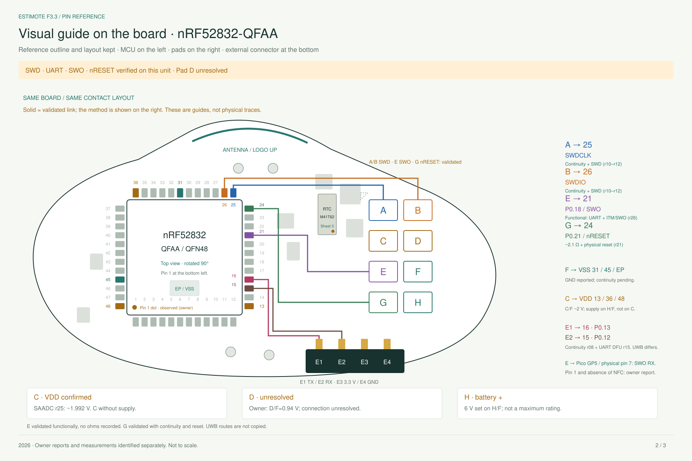

# F3.3 pin reference

Current assignments: **2026**. See the [connection table](guide-f33.md#2-board-connections)
for wiring and power limits.

The [nRF pin guide](diagrams/pin-map-guide-nrf.svg) is the only published
diagram and is also embedded in the main README. Native masters, PNG exports
and the other two diagrams have been retired. [Pin data](pin-candidates.json)
retains the structured assignments and RTC observations.

Antenna up: A/B, C/D, E/F, G/H run down the right side; E1–E4 run left to right.
Pad letters are project conventions. The nRF pin 1 dot is at the bottom left
(owner observation). Solid lines show validated connections, not copper traces.
Pad D remains unresolved. RTC package orientation has not been verified by
continuity; see the [RTC photo evidence](evidence/photos-rtc-r30-2026-11-19/README.md).

`python3 scripts/consolidate_pin_map.py` uses VectorCraft to export only the
published nRF SVG. Incorporate manual edits into the generator first. Verify
`docs/diagrams/SHA256SUMS` after export.
